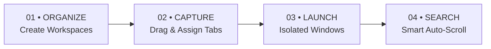

<div align="center">

# 🪐Orbita
### The Modern Workspace Architecture for Your Web

**Transform chaotic browser tabs into clean, purpose-driven workspaces. Switch contexts in one click without losing open tabs or wasting RAM.**

[](https://developer.chrome.com/docs/extensions/mv3/intro/)
[](https://react.dev/)
[](https://www.typescriptlang.org/)
[](https://www.rust-lang.org/)
[](https://vitejs.dev/)
[](https://github.com)
[](LICENSE)

[Features](#-key-features) • [How It Works](#-how-it-works--story) • [Keyboard Shortcuts](#-keyboard-shortcuts) • [Architecture](#-architecture--tech-stack) • [Installation](#-installation--setup) • [Privacy](#-privacy--security)

</div>

---

## 💡 The Philosophy: Why Orbita?

Standard web browsers organize tabs strictly by **chronology** — not by **intent**. Over a typical day, your browser accumulates 30–50 open tabs blending research papers, LeetCode problems, Jira tickets, social feeds, and tutorials into an unmanageable pile.

> **"Organize your web. Focus on what matters."**

**Orbita** shifts browsing from reactive hoarding to **intentional task workspaces**:
- **Zero Session Loss:** Organizing tabs never closes, interrupts, or moves your original browser sessions.
- **Zero RAM Overhead:** Saved workspace tabs stay suspended in lightweight storage until you decide to open them.
- **Clean Window Isolation:** Launch an entire workspace in an isolated, dedicated window without tab-pulling glitches.
- **Real-Time Synchronized:** Live browser tabs appear in a drag-and-drop dock that auto-updates in real time as tabs open, close, or navigate.
- **100% Private & Local:** No external servers, no tracking, and no cloud dependencies. Your data remains strictly on your device.

---

## ✨ Key Features

| Feature | Description |
|---|---|
| 🗂️ **Task Workspaces** | Group pages into intentional workspaces with custom emoji icons, theme colors, categories, and descriptions. |
| 🔄 **Real-Time Live Dock** | An "Open Browser Tabs" dock at the top of your dashboard that updates automatically in real-time as tabs are opened, closed, or moved. |
| 📌 **Drag & Drop Tab Assignment** | Grab any open tab chip from the live dock and drop it directly onto a workspace card to save it instantly. |
| 🚀 **Decoupled Window Launching** | Opens all workspace pages cleanly in a fresh browser window without Chromium's tab-pulling bug. |
| 🌐 **Opera & Chrome Harmony** | Automatically detects Opera (`OPR/`) and bypasses proprietary Tab Islands to prevent erratic window snapping while keeping native tab grouping active in Chrome and Brave. |
| 🔍 **Intelligent Search & Auto-Scroll** | Case-insensitive and whitespace-tolerant search (`Movies `, `MOVIES`, `DSA`). As you type, the dashboard smoothly glides down to center the matching workspace card. |
| ⚙️ **Selective Page Launching** | Inside **Manage Pages**, toggle checkboxes to exclude specific pages from opening during today's session without deleting them. |
| ⚡ **Rust WebAssembly Core** | Integrated WebAssembly module written in Rust for high-speed indexing, data validation, and fuzzy search. |
| 💾 **Backup & Portability** | Full JSON export and import for seamless transfers across Chrome, Opera, Brave, and Edge or offline backups. |
| 🎨 **Refined Light Aesthetic** | Editorial light interface, Plus Jakarta Sans typography, glassmorphism, subtle micro-interactions, and accessible contrast. |

---

## 📖 How It Works & Story

Orbita structures your web life around **4 core pillars**:



### 1. Structure & Spaces
Create workspaces for projects, clients, courses, or entertainment (e.g., *AI/ML Research*, *DSA Practice*, *Movies*, *System Design*). Assign custom colors, category pills, and emoji badges. Press **`Alt + N`** anytime to spawn a workspace instantly.

### 2. Effortless Tab Capture
Never copy-paste URLs again. Active tabs from your current window populate the top dock. Grab any chip and drop it onto a workspace card, or click **Assign Tabs** to multi-select and batch-save open pages with duplicate detection.

### 3. Smart Launch & Window Isolation
Click **Open Workspace** to restore all pages into an isolated new window or your current window. Uncheck specific pages in **Manage Pages** (`Excluded on Open`) to launch only what you need today.

### 4. Smart Search & Auto-Scroll
Search across titles, URLs, categories, and descriptions. Whether you search `"movies"`, `"MOVIES"`, `"MoVies"`, or `"Movies "` with extra spaces, Orbita normalizes the query and smoothly scrolls directly to the card.

---

## ⌨️ Keyboard Shortcuts

Orbita respects native browser hotkeys and provides dedicated, non-conflicting productivity shortcuts:

| Shortcut | Scope | Action |
|---|---|---|
| <kbd>Alt</kbd> + <kbd>D</kbd> | Global (Any Window) | **Open / Focus Orbita Dashboard** scoped to current window |
| <kbd>Alt</kbd> + <kbd>N</kbd> | Inside Dashboard | **Open Create Workspace modal** (un-hijacked native window creation) |
| <kbd>Ctrl</kbd> + <kbd>N</kbd> | Browser Native | **Native New Window** (completely preserved & unblocked) |
| <kbd>Ctrl</kbd> + <kbd>K</kbd> | Inside Dashboard | **Focus Search Bar** |
| <kbd>Enter</kbd> | In Search Bar | **Scroll to matching workspaces** |
| <kbd>Esc</kbd> | Inside Dashboard | **Close modals / dismiss dialogs** |
| **Drag & Drop** | Live Dock | **Drop any tab chip onto a workspace card** |

---

## 🏗️ Architecture & Tech Stack

```text
┌─────────────────────────────────────────────────────────────────┐
│                       ORBITA EXTENSION                          │
├───────────────────────────────┬─────────────────────────────────┤
│         UI Layer              │       Core & Engine             │
│  • React 18 + TypeScript      │  • Manifest V3 Service Worker   │
│  • Plus Jakarta Sans & Icons  │  • Real-Time Tab Event Listeners│
│  • Glassmorphic CSS System    │  • Rust WebAssembly Engine      │
│  • Lucide React Icons         │  • Decoupled Window Manager     │
├───────────────────────────────┴─────────────────────────────────┤
│                       STORAGE & BROWSER                         │
│  • chrome.storage.local (Persistent Offline Storage)            │
│  • chrome.tabs & chrome.windows (Scoped Window Operations)      │
│  • Cross-Browser: Chrome, Brave, Opera (Tab Island Bypass), Edge│
└─────────────────────────────────────────────────────────────────┘
```

- **Frontend:** React 18, TypeScript 5.7, Vite 6
- **Styles:** Custom design tokens, glassmorphism, responsive grid, light-mode native
- **High-Performance Core:** Rust (compiled to WebAssembly via `wasm-pack`)
- **Extension Platform:** Chrome Extension Manifest V3 (`background.service_worker`, `action`, `commands`)
- **Testing:** Vitest for URL normalization, duplicate checks, and storage migrations

---

## 📁 Repository Structure

```text
task/
├── crates/
│   └── core/                    # Rust WebAssembly Core module
│       ├── Cargo.toml           # Rust package config
│       └── src/lib.rs           # Fast fuzzy indexing and query logic
├── public/
│   ├── manifest.json            # Manifest V3 extension configuration
│   ├── popup.html               # Quick toolbar popup with "Open Full Dashboard"
│   ├── dashboard.html           # Dedicated window redirect entrypoint
│   ├── launch.html              # Fallback launcher for multi-window sessions
│   └── icons/                   # High-DPI extension icons (16, 48, 128)
├── src/
│   ├── background/
│   │   └── service-worker.ts    # Background worker: Alt+D command, window scope
│   ├── components/
│   │   ├── Header.tsx           # Search bar, active tab counter, quick actions
│   │   ├── WorkspaceCard.tsx    # Card with split-launch, drag-drop, preview
│   │   ├── WorkspaceDetailsModal.tsx # Manage pages, reorder, exclusion toggles
│   │   ├── CreateWorkspaceModal.tsx  # Workspace editor with emojis & color picker
│   │   ├── TabAssignModal.tsx   # Custom dropdown tab selector & duplicate check
│   │   ├── GuideModal.tsx       # "How It Works & Story" interactive modal
│   │   ├── SettingsModal.tsx    # Preferences, backup JSON export/import
│   │   ├── ConfirmDialog.tsx    # Safe delete confirmations
│   │   └── NotificationToast.tsx# Feedback toasts
│   ├── services/
│   │   ├── browser-adapter.ts   # chrome.tabs, chrome.windows, Opera guard
│   │   └── rust-core.ts         # Rust WebAssembly bridge and sync
│   ├── storage/
│   │   └── workspace-storage.ts # chrome.storage.local persistence & presets
│   ├── types/
│   │   └── workspace.ts         # TypeScript data contracts & models
│   ├── utils/
│   │   └── normalize-url.ts     # URL sanitation & duplicate detection
│   ├── styles/
│   │   └── index.css            # Design tokens, themes, light design system
│   ├── Dashboard.tsx            # Main dashboard orchestration & real-time sync
│   └── main.tsx                 # React DOM mount point
├── dist/                        # Production compiled extension build
├── package.json
├── tsconfig.json
└── vite.config.ts
```

---

## 🚀 Installation & Setup

### Prerequisites
- [Node.js](https://nodejs.org/) (v18.0 or higher)
- [npm](https://www.npmjs.com/) (v9.0 or higher)
- *(Optional for Rust development)* [Rust & wasm-pack](https://rustwasm.github.io/wasm-pack/)

### 1. Clone & Install
```bash
git clone https://github.com/your-username/orbita.git
cd orbita
npm install
```

### 2. Run Local Dev Preview
```bash
npm run dev
```
Open [http://localhost:5173](http://localhost:5173) in your browser. Orbita includes a web preview mode with simulated tabs so you can develop without loading into an extension.

### 3. Run Test Suite
```bash
npm run test
```

### 4. Build Production Extension
```bash
npm run build
```
This builds the unpacked extension bundle directly into the `dist/` directory.

### 5. Package ZIP Archive
```bash
npm run package
```
Generates `my-task-browser-v0.1.0.zip` ready for Chrome Web Store, Opera Addons, or manual distribution.

---

## 🧩 Loading into Your Browser

### Opera / Opera GX
1. Open Opera and enter `opera://extensions` in the URL bar.
2. Toggle on **Developer mode** in the top-right corner.
3. Click **Load unpacked** (top-left).
4. Select the `dist/` directory inside this project folder.
5. Press **`Alt + D`** anywhere to open the dashboard!

### Google Chrome / Brave / Edge
1. Navigate to:
   - **Chrome:** `chrome://extensions/`
   - **Brave:** `brave://extensions/`
   - **Edge:** `edge://extensions/`
2. Turn ON **Developer mode**.
3. Click **Load unpacked** and choose the `dist/` folder.
4. Pin **Orbita** to your browser toolbar for one-click access.

---

## 🔒 Privacy & Security

Orbita adheres to a strict **zero-telemetry, local-first** privacy architecture:

| Permission | Reason |
|---|---|
| `storage` | Stores workspace definitions, bookmarks, and user preferences locally via `chrome.storage.local`. |
| `tabs` | Reads open tabs when dragging or assigning them to workspaces, and opens tabs when launching a workspace. |
| `windows` | Opens dedicated, clean windows for workspaces and scopes tabs to the current window. |
| `tabGroups` | Optionally colors and groups tabs natively in Chromium (Chrome & Brave). |

- 🚫 **No Tracking or Analytics:** No cookies, no telemetry, no Google Analytics.
- 🚫 **No External API Calls:** Saved links never touch third-party servers.
- 🚫 **No Network Requests:** Completely functional offline without an internet connection.

---

## 🤝 Contributing

Contributions, feedback, and feature suggestions are welcome!

1. Fork the Project
2. Create your Feature Branch (`git checkout -b feature/AmazingFeature`)
3. Commit your Changes (`git commit -m 'Add some AmazingFeature'`)
4. Push to the Branch (`git push origin feature/AmazingFeature`)
5. Open a Pull Request

---

## 📄 License

Distributed under the **MIT License**. See `LICENSE` for more information.

<div align="center">

Made with care for intentional web browsing.

**[Back to Top ↑](#-orbita)**

</div>
